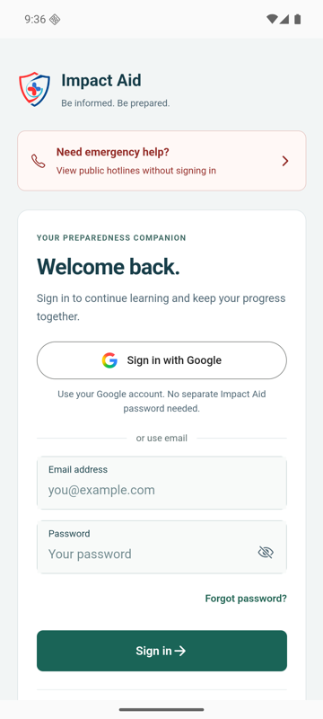
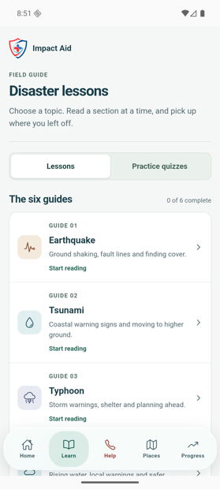
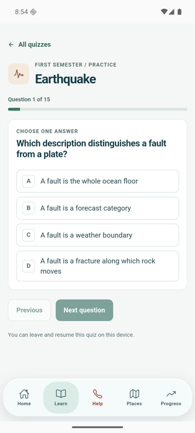
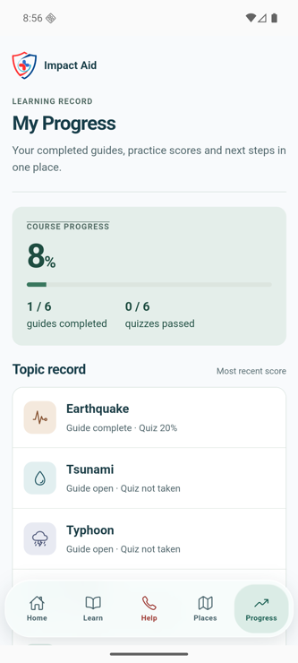
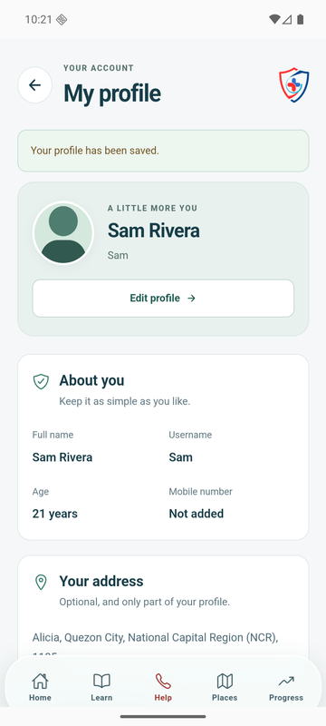
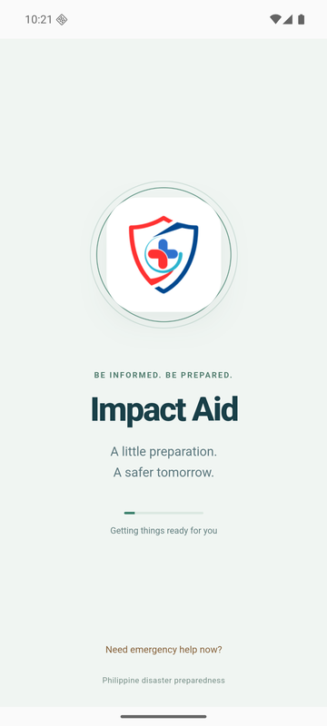
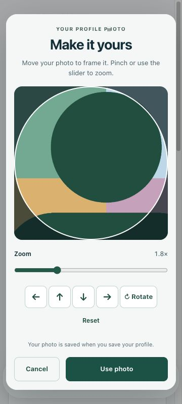

# Impact Aid

A Philippine disaster preparedness app for Android. Find a nearby response facility, read a field guide, or practice what to do before, during and after a disaster.

**[Download the signed Android APK](https://github.com/Imbatzyyy/Impact-Aid/releases/download/v2.4.0/Impact-Aid-2.4.0.apk)** · [Installation and checksum](release/INSTALL.md) · [Release notes](https://github.com/Imbatzyyy/Impact-Aid/releases/tag/v2.4.0)

| In the app | What you can do |
| --- | --- |
| Emergency help | Open public emergency numbers and the places directory without an account. The Call button opens your dialer. |
| Places | Find hospitals, police, fire stations, rescue/DRRM teams, local government offices and mapped evacuation facilities. See the phone’s reported location accuracy and open a pin for its address, available contacts and source. |
| Learn | Read six illustrated guides in sections or watch their bundled videos. Return to your saved section and explicitly mark a guide complete. |
| Practice | Take 15 questions from each topic’s bank of 50. Both question and choice order shuffle. Leave and resume on the same installation. |
| My Profile | Edit your name, username, optional age, mobile number and Philippine address; choose and frame a private profile photo with circular cropping. |
| My Progress | See completed guides, latest quiz scores, recent attempts, badges and a downloadable course certificate. |

## Inside the Android app

| Sign in | Field guides | Practice question | My Progress |
| --- | --- | --- | --- |
|  |  |  |  |

## Sign in with Google

Choose **Sign in with Google** or **Sign up with Google**. Supabase creates a new profile on the first visit and signs returning users into their existing account. Android opens the system browser and returns through a PKCE-protected callback. Email/password and signup confirmation codes remain available. Forgot password sends an email link to the secure [reset website](https://imbatzyyy.github.io/Impact-Aid/reset-password.html). [Configuration and testing notes](docs/GOOGLE-SIGN-IN.md).

[About Impact Aid](https://imbatzyyy.github.io/Impact-Aid/) · [Privacy information](https://imbatzyyy.github.io/Impact-Aid/privacy.html) · [Terms](https://imbatzyyy.github.io/Impact-Aid/terms.html)

## Your profile and a calmer start

The Impact Aid shield is the Android app icon. A short pulsing splash (about two seconds) leads into Home (or sign-in for a signed-out user), with immediate access to emergency help. Tap your Home avatar for My Profile. Photos have a circular preview with drag, pinch, zoom and rotation. Address fields offer suggestions as you type, and your chosen photo appears on Home after saving. Profile details and photos are private to your account. [Profile, address and recovery details](docs/PROFILE-AND-RECOVERY.md).

| My Profile | A calmer welcome |
| --- | --- |
|  |  |

## How quiz releases work

The [QC academic calendar](docs/QUIZ-RELEASES.md) controls releases in Manila time. Supabase assigns a distinct set per topic, term, account and installation. The same installation can keep practicing its set; another installation gets a different combination. Supabase checks the 15 assigned IDs, grades the original answer choices, saves the attempt once and updates the topic score. Existing scores remain visible.

## Run locally

Use Node 24, Java 21, Android SDK 36 and an up-to-date Android System WebView. The Android minimum is API 24. The app uses Angular, Ionic, Capacitor, Leaflet and Supabase. Exact dependency versions are in the lockfile.

```sh
npm ci
npm run lint
npm test
npm start
```

To build Android, set `JAVA_HOME` to JDK 21 and run `npm run build:android`. The unsigned Gradle artifact is under `android/app/build/outputs/apk/release/`. On the maintainer’s Mac, `python3 scripts/sign-android.py` signs it with the existing private release key. Keep that key outside Git and preserve it for updates.

## Data and connectivity

Supabase handles email verification, password recovery, profiles, personal contacts, reading positions and quiz records. SQL migrations and email templates are in [supabase](supabase/). The APK uses a publishable key; privileged credentials and signing materials are excluded from this repository. Resend delivers account mail through Supabase SMTP.

The [17,294-place directory](docs/EMERGENCY-DIRECTORY.md) and lesson media ship with the APK. Map imagery, directions, account data, semester assignments and progress sync need internet. Quiz answers remain on this installation until a submission succeeds. Directory coverage and contact details can be incomplete; confirm shelter activation and access with the local authority. Impact Aid does not dispatch responders or report live road or shelter conditions.

### Frame your photo

Choose **My Profile → Edit profile → Change photo**, position your photo in the circle, and tap **Use photo**. Save your profile to update the photo on Home. Cancelling keeps your previous photo.


